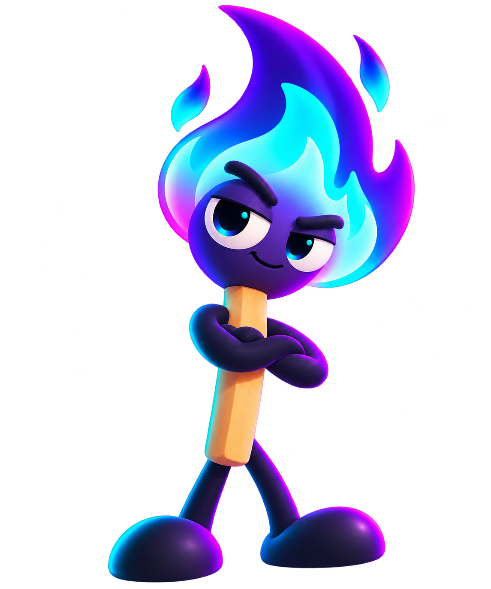
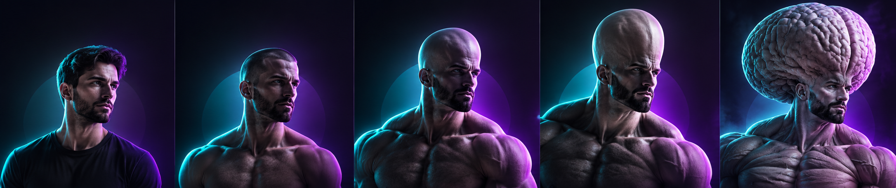

# MogMatch

### Find the developer whose skills *intersect* with yours.

Build a profile, get **mogged** by our scoring engine, swipe through developers who complete your stack, and turn a match into a project you build together.

 

  

Built in 24 hours for the Social Coding Hackathon · theme: <b>Connect &amp; Intersect</b>

---

## 💜 What is MogMatch?

Hackathon teams fail when everyone knows the same three things. MogMatch is matchmaking for developers: it looks at what you know, what you want to build and who you want to meet, then shows you the people whose skills **overlap enough to talk, and differ enough to matter**.

Swipe. Match. Chat. Ship something together.

---

## ✨ Features

### 🧭 Discover developers
Swipe through developer profiles: skills, projects, interests, favorite IDE, AI agents and what they're looking for (hackathon team, side project, cofounder, mentor…). Search for anything, filter by skills, interests and goals, or sort by **biggest moggers first**. ❤ to like, ✕ to pass, or open someone's full profile and like them from there.

### 🔥 The Mog Score
Every profile gets a **0–100 Mog Score**, and every point is earned and explained. Ship real projects, write real descriptions, fill in your profile, and know a language nobody else does: **the more esoteric your stack, the harder you mog.** A Haskell project beats a Python one. COBOL beats them both.

| 🥚 Hello World | 🐣 Junior Mogger | 🧑‍💻 Mid Mogger | 🔥 Senior Mogger | 👑 Gigamogger |
|:---:|:---:|:---:|:---:|:---:|
| 0–24 | 25–44 | 45–64 | 65–84 | 85–100 |
| *Just compiled their first print statement.* | *Knows what a semicolon is. Mostly.* | *Deploys on Fridays. It usually works.* | *Their rubber duck asks them for advice.* | *Writes Haskell for fun. Compilers apologize to them.* |

Your own score comes with a breakdown bar for every category and (slightly rude) tips on how to climb.

### 💞 Mog Match
Everyone you like lands on your **Match** page, ranked by how similar you are: shared tech stack, interests, goals, experience, even whether you both swear by the same IDE. Each match explains itself in plain English: *"6 shared skills: React, TypeScript, Node.js…"*.

### 📨 Match requests & inbox
Like someone? Send them a **match request** with a message. It lands in their inbox right away; they accept or decline, and you see the answer without refreshing.

### 🏆 Team Mog Score
Accept a match and the two of you get a **Team Mog Score out of 1000**, with a dramatic reveal. It rewards combined strength, how many specialties you cover between you, and the sweet spot of complementary skills: different enough to fill each other's gaps, with enough in common to talk shop.

### 💬 Real-time chat + AI project studio
Accepted matches open a **live chat**, with messages delivered instantly over WebSockets. Stuck on what to build? The **AI project studio** turns your shared skills into a project plan the two of you can actually ship. Things not working out? **Unmatch** (and request a rematch later) or **block**, right from the chat.

### 🎨 Profiles with personality
Upload a photo, show off your projects, and give your profile its own **theme**: a custom dark background plus one of seven live animated effects drawn behind your card:

| 🟩 Matrix rain | 📀 Bouncing DVD logo | 🦄 Floating emoji | 📣 Gym-bro slogans | 📈 Fake stock market | 💸 Money rain | ❄️ Snowfall |
|:---:|:---:|:---:|:---:|:---:|:---:|:---:|

Every effect is tunable: colors, speed, size, glow, emoji, slogans, wind, how unhinged the market is…

### 🔐 Your account
Sign up in seconds with a username and password, then build out your profile. Change your display name or password any time in Settings.

---

## 🚀 Try it

**Live:** **[mog-match.vercel.app](https://mog-match.vercel.app)**. Create an account and start swiping.

**On your machine:** the app comes with **60+ demo developers** across every Mog tier, each with a backstory, projects, a profile picture and their own theme. Log in as `gigachad` / `123` to see a 👑 Gigamogger, or `newbie` / `123` for the other end of the scale. Setup takes a few commands: see the [developer guide](docs/DEVELOPMENT.md#prerequisites).

---

## 🛠️ For developers

| 📘 [Developer guide](docs/DEVELOPMENT.md) | 🏗️ [Architecture](docs/ARCHITECTURE.md) | 🚢 [Deploying to Vercel](docs/DEPLOY.md) |
|:---:|:---:|:---:|
| Setup, environment variables, seed data, API reference | The key design decisions, and why | Postgres, environment variables, automatic database setup |
| 🔥 [Mog Score](docs/MOG_SCORE.md) · 💞 [Mog Match](docs/MOG_MATCH.md) | 💬 [Chat & studio](docs/CHAT.md) | 🗺️ [Roadmap](docs/ROADMAP.md) · 🤝 [Contributing](CONTRIBUTING.md) |
| Every scoring and similarity rule | Real-time events, AI studio setup | What's next, and how to send a PR |

 
Made with 💜, caffeine and questionable sleep by the MogMatch team.

