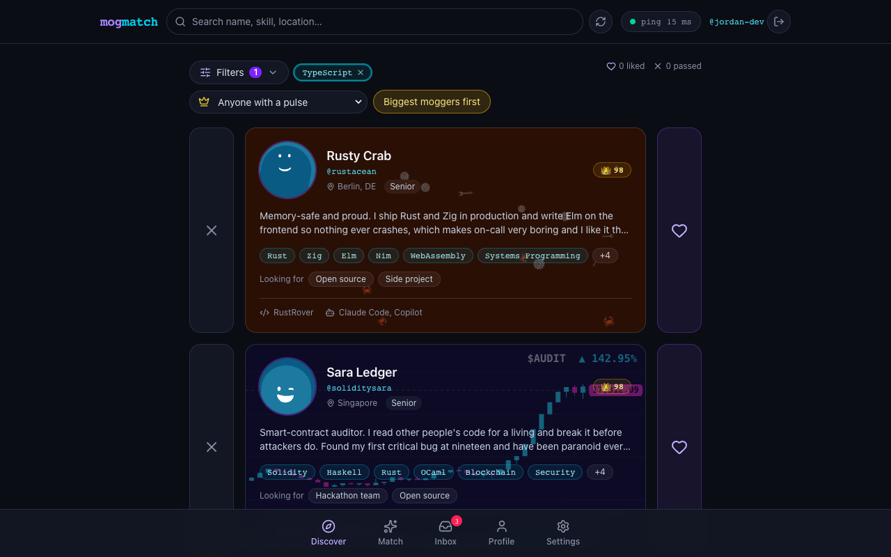
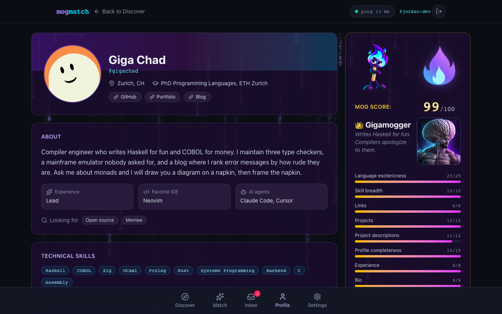
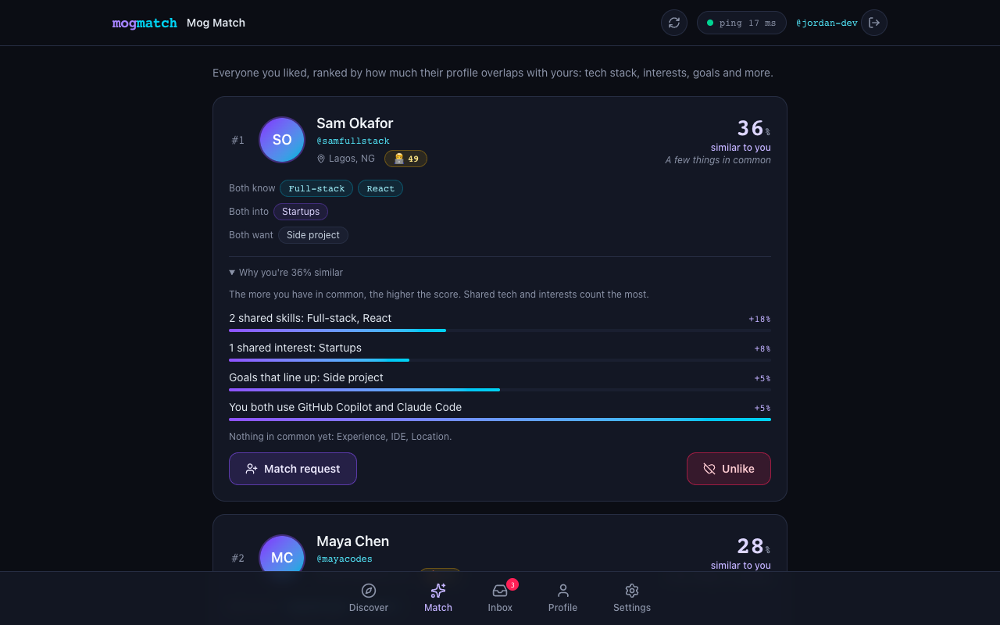
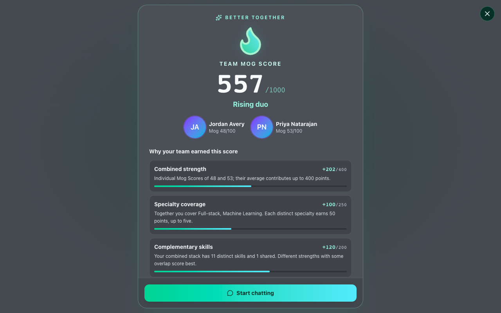
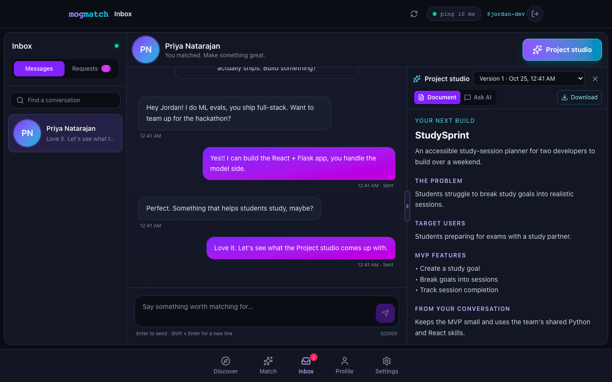
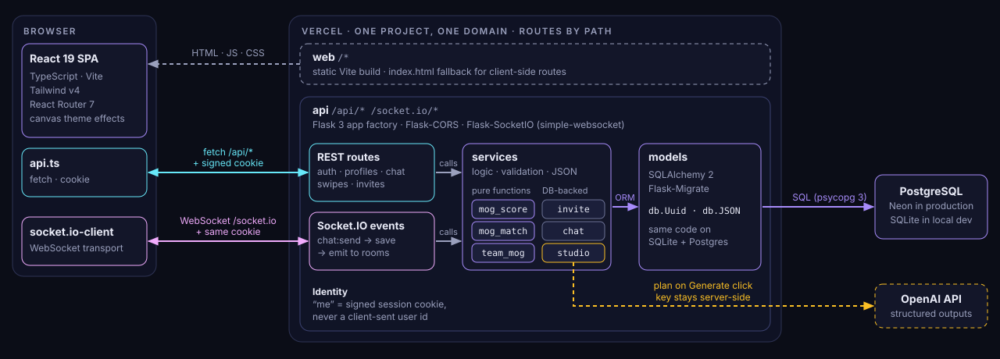

<!-- Present with Marp: VS Code "Marp for VS Code" extension (Open Preview / Export), or
     `npx @marp-team/marp-cli docs/presentation/slides.md --pdf --allow-local-files`.
     Speaker notes are the HTML comments under each slide. Total talk time: about 1 minute. -->

<!-- _class: lead -->

# mogmatch 💜

### Tinder for developers.
Find a teammate whose skills **complement** yours, then build something together.

*Hackathon theme: Connect & Intersect*

<!-- (~6s) MogMatch is matchmaking for developers: find a teammate whose skills complement yours, then build something together. -->

---

## 🔎 Discover

- Search + filter by **skill, goal, tier**
- **Mog Score** badge on every card
- **Like** or **Pass**

<!-- (~8s) Discover lets you search and filter developers by skill, goal and tier. Every card shows a Mog Score. -->

---

## 👑 Mog Score

- **0–100** profile rating
- Weird languages win: **COBOL beats Python**
- 🥚 Hello World → 👑 Gigamogger
- Animated profile themes

<!-- (~10s) Every profile gets a Mog Score out of a hundred, and obscure languages score highest. Gigamoggers even get animated themes. -->

---

## 💘 Mog Match

- Likes **ranked by similarity**
- Shows *why*: skills, interests, goals
- One tap to send a **match request**

<!-- (~8s) Liked profiles are ranked by how much you overlap, with the exact reasons. Then you send a match request. -->

---

## 🔥 Team Mog Score

- Accept a request, both get a **reveal**
- Scored out of **1000**
- Rewards *complementary* skills, not clones

<!-- (~10s) When a request is accepted, you both get a Team Mog Score out of a thousand. It rewards complementary skills, and shows why. -->

---

## 💬 Chat + Studio

- **Real-time chat**
- **Project Studio**: AI drafts a shared **project plan** from your chat and both profiles
- Versioned, **downloadable**

<!-- (~10s) Then chat live. Project Studio uses both profiles and your conversation to draft a shared project plan you can download. -->

---

<!-- _class: arch -->

## 🧱 Under the hood

One domain, one signed cookie: Vercel sends `/api/*` and `/socket.io/*` to Flask, everything else to the static React app.

<!-- (~10s) Vercel serves the React app and routes API and WebSocket traffic to one Flask app. Postgres stores everything, and OpenAI is only ever called server-side. -->

---

<!-- _class: lead -->

## Next: the Intersect Engine 🧩

Project ideas generated from where two developers' skills *intersect*.

# Thanks! 💜

<!-- (~5s) Next up is the Intersect Engine. Thanks! -->
